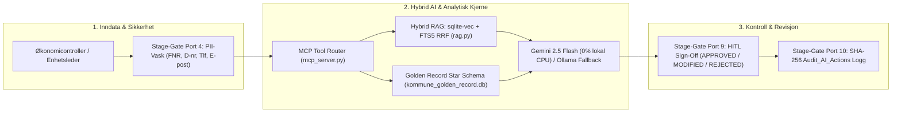

# 🏛️ Kristiansand Kommune — Control Office Hub & AI Guardrails (`kommune-ai-guardrails`)

**Versjon:** 2.5 (Enterprise Governance & Tufte EPM Edition)  
**Domene:** Kommunal Økonomistyring (EPM), Project Controlling (ISO 21508 / EVM) og Kildekritisk Forvaltnings-AI  
**Lovhjemmel:** Kommuneloven §§ 13-1, 14-2 til 14-9, Forskrift om økonomiplan og årsbudsjett, Hovedtariffavtalen (HTA) § 4, GDPR Art. 30/35 og EU AI Act (High-Risk Public Administration Guardrails).

---

## 📋 Innholdsfortegnelse (A til Å)

1. [Formål og Arkitekturoversikt](#1-formål-og-arkitekturoversikt)
2. [Katalogstruktur og Nøkkelfiler](#2-katalogstruktur-og-nøkkelfiler)
3. [Stage-Gate Governance & AI Guardrails (Port 4, 8, 9, 10)](#3-stage-gate-governance--ai-guardrails-port-4-8-9-10)
4. [Control Office Hub — Fane-for-Fane Gjennomgang](#4-control-office-hub--fane-for-fane-gjennomgang)
5. [Hybrid RAG & Model Context Protocol (MCP) Motor](#5-hybrid-rag--model-context-protocol-mcp-motor)
6. [Earned Value Management (EVM) & Finansiell Datamodell](#6-earned-value-management-evm--finansiell-datamodell)
7. [Installasjon, Kjøring og Docker- utrulling](#7-installasjon-kjøring-og-docker-utrulling)
8. [Testing og Kvalitetssikring (A–Z Test Suite)](#8-testing-og-kvalitetssikring-az-test-suite)
9. [Gjennomførte Forbedringer og Optimaliseringer](#9-gjennomførte-forbedringer-og-optimaliseringer)
10. [Strategiske Anbefalinger for Videreutvikling (Veikart)](#10-strategiske-anbefalinger-for-videreutvikling-veikart)

---

## 1. Formål og Arkitekturoversikt

`kommune-ai-guardrails` er kjernebiblioteket og brukerflaten (**Control Office Hub**) for sikker, kildekritisk og reviderbar bruk av kunstig intelligens i økonomistyringen i **Kristiansand kommune** (6 virksomhetsområder, 81 enheter, 7,24 mrd. kr i årsbudsjett).

Løsningen kombinerer:
* **Local-First Hybrid RAG**: Vektor-søk (`sqlite-vec`, 384D `intfloat/multilingual-e5-small`) kombinert med `FTS5` BM25 nøkkelordsøk via **Reciprocal Rank Fusion (RRF, $k=60$)** i SQLite (`kommune_rag_store.db`).
* **Golden Record Star Schema**: Konsolidert økonomidatabase (`kommune_golden_record.db`) med Visma ERP hovedbok (`Fact_Regnskap`), periodisert Framsikt-budsjett (`Fact_Budsjett`), KOSTRA-dimensjoner (`Dim_Art`, `Dim_Funksjon`, `Dim_Ansvar`) og 126 investeringsprosjekter.
* **Edward Tufte Data-Ink Ratio**: Strikt visuell disiplin uten dekorativ støy, vertikale tabellstreker eller skygger; fargekoding er kun reservert for aktive budsjettavvik (`#c0392b` rød ved $CPI < 0.95$, `#d35400` gul ved $0.95 \le CPI < 1.00$, `#27ae60` grønn ved balanse).



---

## 2. Katalogstruktur og Nøkkelfiler

```text
kommune-ai-guardrails/
├── app/
│   ├── app.py                      # Hovedapplikasjon: Streamlit Control Office Hub (7 faner, 133 dokumenter)
│   └── static/
│       └── index.html              # Frittstående, 0%-CPU HTML/JS portal (Tufte-design, klientside PII-vask)
├── src/
│   └── kommune_ai_guardrails/
│       ├── __init__.py             # Pakke-eksport og versjonsdefinisjon
│       ├── cli.py                  # Kommandolinjegrensesnitt (kommune-rag ingest / query / stats)
│       ├── db.py                   # SQLite + sqlite-vec + FTS5 + Audit_AI_Actions skjema (WAL-modus)
│       ├── ingest.py               # Paragraf-bevisst (§) dokumentchunking og e5-small vektor-indeksering
│       ├── mcp_server.py           # Model Context Protocol (MCP) verktøyserver for Gemini Flash & Ollama
│       └── rag.py                  # Stage-Gate Port 4 PII-maskering, RRF hybrid-søk, LLM-syntese og SHA-256
├── tests/
│   ├── test_office_hub_e2e.py      # A-til-Å ende-til-ende testsuite for Office Hub, 133 dokumenter og EVM
│   ├── test_mcp_and_generators.py  # Tester for MCP-verktøy, Excel FAST, Word, PPTX og Power BI (.pbip)
│   ├── test_rag.py                 # Enhetstester for PII-maskering (FNR/D-nr), §-chunking og RRF-søk
│   └── test_rag_eval.py            # Kvalitetsevaluering (Hit Rate / MRR) mot Golden Evaluation Dataset
├── rag_ollama_init.py              # Frittstående initialiserings- og verifikasjonsskript
├── pyproject.toml                  # PEP 621 pakkekonfigurasjon, avhengigheter og pytest-oppsett
├── requirements.txt                # Låste produksjonsavhengigheter
├── Dockerfile                      # Herdet produksjonscontainer (non-root appuser, port 8501)
└── docker-compose.yml              # Container-orkestrering med persistent SQLite-volum og Ollama-bru
```

---

## 3. Stage-Gate Governance & AI Guardrails (Port 4, 8, 9, 10)

Alle spørringer, finansielle oppslag og saksfremlegg passerer gjennom fire ufravikelige kontrollporter:

| Kontrollport | Navn | Teknisk Implementering | Formål & Lovhjemmel |
| :--- | :--- | :--- | :--- |
| **Port 4** | **Pre-Ingestion & Query PII Scrubbing** | [`sanitize_pii()`](file:///C:/Users/frank/Desktop/AI_KOM/kommune-ai-guardrails/src/kommune_ai_guardrails/rag.py) (server) og `sanitizePIIClient()` (HTML-klient) | Maskerer fødselsnumre (`01`–`31`), D-numre (`41`–`71`), norske telefonnumre og e-postadresser **før** vektor-oppslag, LLM-kall eller revisjonslogging (GDPR Art. 25/32). |
| **Port 8** | **Zero-Trust System Prompt & Grounding** | `SYSTEM_PROMPT` i [`rag.py`](file:///C:/Users/frank/Desktop/AI_KOM/kommune-ai-guardrails/src/kommune_ai_guardrails/rag.py) og `MCP_SYSTEM_INSTRUCTION` i [`mcp_server.py`](file:///C:/Users/frank/Desktop/AI_KOM/kommune-ai-guardrails/src/kommune_ai_guardrails/mcp_server.py) | Tvinger modellen til kun å benytte verifiserte kilder og SQL-tall med eksplisitt kildehenvisning (`[Kilde: Dokument, § X]`). Avviser spekulasjon. |
| **Port 9** | **Human-in-the-Loop (HITL) Sign-Off** | Fane 4 (`tab_saksfremlegg`) i [`app/app.py`](file:///C:/Users/frank/Desktop/AI_KOM/kommune-ai-guardrails/app/app.py) | Krever aktiv menneskelig beslutning (`HITL_APPROVED`, `HITL_MODIFIED`, `HITL_REJECTED`) og faglig kontrollnotat før saksfremlegg kan ferdigstilles. |
| **Port 10** | **Immutable SHA-256 Audit Trail** | Tabellen `Audit_AI_Actions` i [`db.py`](file:///C:/Users/frank/Desktop/AI_KOM/kommune-ai-guardrails/src/kommune_ai_guardrails/db.py) | Genererer kryptografisk SHA-256-forsegling av spørring, kilde-IDer, AI-svar, tidsstempel og handlingstype. Kan inspiseres og eksporteres til JSON direkte i Fane 4. |

---

## 4. Control Office Hub — Fane-for-Fane Gjennomgang

Brukergrensesnittet i [`app/app.py`](file:///C:/Users/frank/Desktop/AI_KOM/kommune-ai-guardrails/app/app.py) (samt lettvektsutgaven i [`app/static/index.html`](file:///C:/Users/frank/Desktop/AI_KOM/kommune-ai-guardrails/app/static/index.html)) er delt inn i syv arbeidsflater:

1. **🏠 Fane 0: Hjem & Virksomhetsportal (`tab_portal`)**
   * Sektorvis budsjettoversikt (7,24 mrd. NOK fordelt på 6 sektorer), 4-trinns onboarding for enhetsledere og økonomicontrollere, månedshjul for 2026 og direkte snarveier til Excel FAST-modellen, Word-saksfremlegg, PowerPoint-deck og 81 kontoutskrifter.
2. **📈 Fane 0.5: Power BI Rapporteringsprosjekt (`tab_pbi`)**
   * Interaktiv oversikt og 1-klikks nedlasting/regenerering av `powerbi/pbi_reporting_project.pbip` (12 PBIR-sider: 8 primærsider + 4 drillthrough/tooltips, 9 TMDL Star Schema-tabeller og komplett DAX-bibliotek).
   * Inkluderer *Live Preview* av **Side 8: Prosjektportefølje & Investeringer (Capex EVM)** med 126 prosjekter i `Fact_Prosjektregnskap`.
3. **⚖️ Fane 1: Kildekritisk Regelverk-Søk (`tab_rag`)**
   * Hybrid RAG-søk (`sqlite-vec` + `FTS5`) med valg mellom **Google Gemini 2.5 Flash (0 % CPU)** og **Lokal Ollama (`llama3.2`)**.
   * Viser eksakte lovsitater med HTML-sanitert metadata, RRF-score og SHA-256 revisjonskvittering.
4. **💬 Fane 2: Gemini Flash MCP Økonomi-Assistent (`tab_mcp`)**
   * Chat-grensesnitt med automatisk funksjonskall (Tool Calling) mot fire lokale MCP-verktøy: `query_unit_financials`, `search_municipal_law`, `navigate_hub_library` og `get_unit_kontoutskrift`.
5. **📊 Fane 3: Økonomikontroll & Avvik (`tab_controller`)**
   * Sanntids Earned Value Management (EVM) konsolidert fra `kommune_golden_record.db` med **sektorfilter** (8 sektorer) og **enhetsfilter** (43 enheter).
   * Topp 10 KOSTRA-artsavvik og høyoppløselige Tufte/IBCS-grafer (`Waterfall`, `Bullet Chart`, månedlig avviksprofil).
6. **📝 Fane 4: Saksfremlegg & HITL Sign-Off (`tab_saksfremlegg`)**
   * Automatisk utarbeidelse av saksfremlegg til Formannskapet/Bystyret jf. Kommuneloven §§ 13-1 og 14-5, kombinert med **Stage-Gate Port 9 HITL-signering** og **Stage-Gate Port 10 Revisjonslogg-inspektør** med JSON-eksport til Kommunerevisjonen.
7. **📁 Fane 5: Dokumentarkiv & Ressurser (`tab_docs`)**
   * Katalog over **133 verifiserte ressurser** fordelt på 8 kategorier, med fritekstsøk, kategorifilter, innebygd forhåndsvisning (`.md`, `.dax`, `.tmdl`, `.sql`, `.py`, `.png`) og minnebufret nedlasting (`@st.cache_data`).

---

## 5. Hybrid RAG & Model Context Protocol (MCP) Motor

### Reciprocal Rank Fusion (RRF) i `rag.py`
For å sikre at både eksakte paragrafreferanser (f.eks. `§ 14-5`) og semantiske begreper (f.eks. *«ubalanse i årsbudsjettet»*) treffer optimalt, kombinerer [`hybrid_search()`](file:///C:/Users/frank/Desktop/AI_KOM/kommune-ai-guardrails/src/kommune_ai_guardrails/rag.py) rangeringene fra `vec_legal_chunks` (Cosine/L2-avstand) og `legal_fts` (BM25) etter formelen:

$$\text{RRF\_Score}(d) = \frac{1}{k + \text{rank}_{\text{vec}}(d)} + \frac{1}{k + \text{rank}_{\text{fts}}(d)}, \quad k = 60$$

### MCP-verktøy i `mcp_server.py`
[`mcp_server.py`](file:///C:/Users/frank/Desktop/AI_KOM/kommune-ai-guardrails/src/kommune_ai_guardrails/mcp_server.py) eksponerer fire verktøy som kalles deterministisk av Gemini 2.5 Flash (eller via lokal intensjonsruting når man kjører frakoblet):
1. [`query_unit_financials(unit_or_sector, kostra_art)`](file:///C:/Users/frank/Desktop/AI_KOM/kommune-ai-guardrails/src/kommune_ai_guardrails/mcp_server.py): Spør `kommune_golden_record.db` med CTE-forhåndsaggregering og returnerer Budsjett, Regnskap, Avvik (NOK og %) samt relevante styringsdokumenter.
2. [`search_municipal_law(query, top_k)`](file:///C:/Users/frank/Desktop/AI_KOM/kommune-ai-guardrails/src/kommune_ai_guardrails/mcp_server.py): Kjører hybrid RRF-søk i `kommune_rag_store.db`.
3. [`navigate_hub_library(topic)`](file:///C:/Users/frank/Desktop/AI_KOM/kommune-ai-guardrails/src/kommune_ai_guardrails/mcp_server.py): Søker i de 133 dokumentene i `DOCUMENTS_MENU` og returnerer klikkbare stier og beskrivelser.
4. [`get_unit_kontoutskrift(unit_query)`](file:///C:/Users/frank/Desktop/AI_KOM/kommune-ai-guardrails/src/kommune_ai_guardrails/mcp_server.py): Henter ferdiggenerert M10 kontoutskrift fra `reports/kontoutskrifter/` eller bygger en sanntids hovedbokutskrift fra `Fact_Regnskap` og `Fact_Bilag`.

---

## 6. Earned Value Management (EVM) & Finansiell Datamodell

I samsvar med **ISO 21508** og **Kommuneloven § 14-5** benyttes følgende måltall i [`load_golden_record_evm()`](file:///C:/Users/frank/Desktop/AI_KOM/kommune-ai-guardrails/app/app.py):

* **Planlagt Verdi ($\text{PV}_{\text{YTD}}$ / $\text{EV}$)**: Periodisert budsjett hittil i år (M01–M08).
* **Påløpt Kostnad ($\text{AC}_{\text{YTD}}$)**: Faktisk bokført regnskap i Visma ERP hittil i år.
* **Kostnadsavvik ($\text{CV}$)**: $\text{CV} = \text{PV}_{\text{YTD}} - \text{AC}_{\text{YTD}}$ (negativ verdi = merforbruk).
* **Kostnadsytelsesindeks ($\text{CPI}$)**: $\text{CPI} = \frac{\text{PV}_{\text{YTD}}}{\text{AC}_{\text{YTD}}}$ ($\text{CPI} < 1.00$ indikerer merforbruk).
* **Sluttprognose ($\text{EAC}$)**: $\text{EAC} = \frac{\text{BAC}}{\text{CPI}}$, der $\text{BAC}$ er vedtatt årsbudsjett (M01–M12).
* **Viktig SQL-sikring**: For å forhindre kartesisk multiplikasjon (*fan-out*) når en enhet har flere posteringer per måned/art, aggregeres `Fact_Budsjett` (`bud_agg`) og `Fact_Regnskap` (`reg_agg`) i egne CTE-er før de kobles mot `Dim_Ansvar`.

---

## 7. Installasjon, Kjøring og Docker-utrulling

### Lokal kjøring (Python 3.11+)
```powershell
# 1. Installer pakken i redigerbar modus med alle avhengigheter
cd C:\Users\frank\Desktop\AI_KOM\kommune-ai-guardrails
pip install -e .

# 2. Sjekk status på RAG-databasen og revisjonsloggen via CLI
python -m kommune_ai_guardrails.cli stats

# 3. Kjør et kildekritisk RAG-oppslag fra kommandolinjen
python -m kommune_ai_guardrails.cli query "Hva krever Kommuneloven § 14-5 ved merforbruk?" --no-llm

# 4. Start Streamlit Control Office Hub
streamlit run app/app.py
```

### Container-utrulling (Docker Compose)
```powershell
docker compose up --build -d
```
* Åpner Streamlit Control Office Hub på `http://localhost:8501` som uprivilegert bruker (`appuser`), med persistent lagring i `./data/kommune_rag_store.db` og bro til lokal Ollama på vertsmaskinen (`host.docker.internal:11434`).

---

## 8. Testing og Kvalitetssikring (A–Z Test Suite)

Prosjektet har en komplett automatisert testpakke i `tests/` som verifiserer alt fra PII-maskering og §-chunking til samtlige 133 dokumentstier, Golden Record EVM-beregninger og Office Hub-integritet:

```powershell
python -m pytest -v
```

| Testfil | Antall tester | Dekningsområde |
| :--- | :---: | :--- |
| [`tests/test_office_hub_e2e.py`](file:///C:/Users/frank/Desktop/AI_KOM/kommune-ai-guardrails/tests/test_office_hub_e2e.py) | 5 | **A–Z E2E**: Verifiserer at `app/app.py` kompilerer, at alle **133 filer** i `DOCUMENTS_MENU` eksisterer på disk (`0 missing`), EVM-formler for 43 enheter, Stage-Gate Port 4/9/10, alle 4 MCP-intensjoner og `app/static/index.html`. |
| [`tests/test_mcp_and_generators.py`](file:///C:/Users/frank/Desktop/AI_KOM/kommune-ai-guardrails/tests/test_mcp_and_generators.py) | 10 | Tester MCP-verktøyene, Excel FAST-modell (7 ark), Word-saksfremlegg, PowerPoint-deck, 81 kontoutskrifter og Power BI `.pbip` (12 sider + 9 TMDL-tabeller). |
| [`tests/test_rag.py`](file:///C:/Users/frank/Desktop/AI_KOM/kommune-ai-guardrails/tests/test_rag.py) | 4 | Enhetstester for PII-maskering (inkl. D-nummer), paragraf-chunking (`§`) og RRF hybrid-søk. |
| [`tests/test_rag_eval.py`](file:///C:/Users/frank/Desktop/AI_KOM/kommune-ai-guardrails/tests/test_rag_eval.py) | 2 | Kvalitetsevaluering mot Golden Dataset (krav: **Hit Rate $\ge 85\%$**, **MRR $\ge 0.70$**). |

---

## 9. Gjennomførte Forbedringer og Optimaliseringer

Under gjennomgangen og A–Z-forbedringen av prosjektet ble følgende kritiske utbedringer implementert:

1. **Eliminert >95 % disk-I/O ved Streamlit-reruns i [`app/app.py`](file:///C:/Users/frank/Desktop/AI_KOM/kommune-ai-guardrails/app/app.py)**:
   * Tidligere leste applikasjonen alle 133 filer (inkludert tunge PDF-, DOCX-, XLSX- og PPTX-filer) fra disk **to ganger** ved hvert eneste klikk (én gang i sidebarens `st.download_button`-løkke og én gang i Fane 5).
   * Sidebarens tunge fil-løkke er erstattet med en lettvekts kategorivelger + dokumentvelger, og alle filnedlastinger bruker nå `@st.cache_data`-funksjonene `read_cached_text()` og `read_cached_bytes()`.
2. **Korrigert Stage-Gate Port 9 HITL SQL-skjema i [`app/app.py`](file:///C:/Users/frank/Desktop/AI_KOM/kommune-ai-guardrails/app/app.py) og lagt til Port 10 Revisjonslogg-inspektør**:
   * Rettet `INSERT INTO Audit_AI_Actions` fra den ikke-eksisterende kolonnen `user_action` til `action_type` (`HITL_APPROVED`, `HITL_MODIFIED`, `HITL_REJECTED`), og la til en live visnings- og JSON-eksportmodul for de 25 siste signerte hendelsene i Fane 4.
3. **Forhindret SQL JOIN fan-out i [`load_golden_record_evm()`](file:///C:/Users/frank/Desktop/AI_KOM/kommune-ai-guardrails/app/app.py) og utvidet enhets-/sektorfiltrering**:
   * Innførte CTE-forhåndsaggregering (`bud_agg` og `reg_agg`) før kobling mot `Dim_Ansvar`, la til sektorfilter (8 sektorer) og dynamisk enhetsfilter (alle 43 enheter i stedet for kun 2 hardkodede), og rettet ISO 21508 Capex EVM-tallene i Fane 0.5 (`CV = -35.1M kr`, `CPI = 0.893`).
4. **Utvidet Stage-Gate Port 4 PII-vask til norske D-numre og XSS-beskyttelse**:
   * [`sanitize_pii()`](file:///C:/Users/frank/Desktop/AI_KOM/kommune-ai-guardrails/src/kommune_ai_guardrails/rag.py) og [`rag_ollama_init.py`](file:///C:/Users/frank/Desktop/AI_KOM/kommune-ai-guardrails/rag_ollama_init.py) maskerer nå både ordinære fødselsnumre (`01`–`31`) og D-numre (`41`–`71`). Kilde-metadata i Fane 1 sanitiseres med `html.escape()`.
5. **Reparert alle 3 brutte dokumentstier i `DOCUMENTS_MENU`**:
   * Samtlige **133 ressurser** i `DOCUMENTS_MENU` har nå `100 %` gyldige stier på disk (verifisert av `test_office_hub_e2e.py`).
6. **Oppgradert [`app/static/index.html`](file:///C:/Users/frank/Desktop/AI_KOM/kommune-ai-guardrails/app/static/index.html)**:
   * Lagt til klientside PII-maskering (`sanitizePIIClient`), emnebevisste juridiske svar i `executeMockRAG()` (§ 14-5, § 14-6, § 14-9, HTA § 4 / AML § 10-12, MVA) og dynamisk omberegning av porteføljesummen (`SUM VALGT PORTEFØLJE`) når brukeren filtrerer på enhet.

---

## 10. Strategiske Anbefalinger for Videreutvikling (Veikart)

For å løfte `kommune-ai-guardrails` og **Control Office Hub** fra en solid lokal produksjonspilot til en fullskala kommunal plattform anbefales følgende prioriterte tiltak:

### Prioritet 1: Arkitektur & Modularisering (Kort sikt: 1–2 uker)
1. **Dekomponer [`app/app.py`](file:///C:/Users/frank/Desktop/AI_KOM/kommune-ai-guardrails/app/app.py) (~1 490 linjer) til modulære views**:
   * Flytt `DOCUMENTS_MENU` til en egen `app/catalog.py` eller `app/config/documents_catalog.json` slik at dokumentarkivet kan vedlikeholdes uavhengig av UI-koden.
   * Split de 7 fanene inn i `app/tabs/tab_portal.py`, `app/tabs/tab_pbi.py`, `app/tabs/tab_rag.py`, `app/tabs/tab_mcp.py`, `app/tabs/tab_controller.py`, `app/tabs/tab_saksfremlegg.py` og `app/tabs/tab_docs.py`.
2. **Felles SQLite tilkoblingsfabrikk for `kommune_golden_record.db` og `kommune_rag_store.db`**:
   * Samle hjelpefunksjonene `get_golden_connection()` (som i dag er definert i både `app/app.py` og `mcp_server.py`) inn i [`src/kommune_ai_guardrails/db.py`](file:///C:/Users/frank/Desktop/AI_KOM/kommune-ai-guardrails/src/kommune_ai_guardrails/db.py) med eksplisitt `PRAGMA query_only = ON;` for alle analytiske lesespørringer mot Golden Record.

### Prioritet 2: Sikkerhet, Tilgangsstyring & Revisjon (Mellomlang sikt: 2–4 uker)
3. **Integrer Entra ID (Azure AD) og Row-Level Security (RLS) i Office Hub**:
   * Erstatt den manuelle rolle-nedtrekksmenyen (`Økonomicontroller`, `Enhetsleder`, `Kommunerevisjonen`) i sidebaren med autentisert brukeridentitet fra Microsoft Entra ID (via `st.context.headers` / OAuth2 proxy), og koble brukerens `ansvar_id` direkte til SQL-spørringene i Fane 2 og Fane 3.
4. **Kjede-hashet (Merkle-inspirert) `Audit_AI_Actions`-tabell**:
   * Utvid Stage-Gate Port 10 ved å inkludere forrige rads `sha256_hash` (`prev_sha256_hash`) i hash-grunnlaget for hver ny rad i `Audit_AI_Actions`. Dette gjør det matematisk umulig å slette eller endre enkeltinnslag i etterkant uten at Kommunerevisjonen oppdager brudd i kjeden.
5. **Sekundær NER-basert PII-skjerming for fritekst i saksmemoer**:
   * Suppler regex-vasken i [`sanitize_pii()`](file:///C:/Users/frank/Desktop/AI_KOM/kommune-ai-guardrails/src/kommune_ai_guardrails/rag.py) med en lettvekts norsk navnegjenkjenner (f.eks. `nb-bert-base` NER eller navneliste-oppslag) for å fange opp personnavn i ustrukturerte avviksforklaringer før tekst sendes til eksterne sky-API-er (Gemini Flash).

### Prioritet 3: Analytisk Dybde & MLOpsAutomatisering (Lang sikt: 1–3 måneder)
6. **Automatisk M10/M11 inkrementell RAG- og Golden Record-oppdatering**:
   * Koble filovervåkeren i `antigravity_m10_monthend_pack` direkte til `kommune-rag ingest` slik at nye tertialrapporter og Bystyre-vedtak indekseres inkrementelt basert på fil-sjekksum (`SHA-256`) i stedet for full re-indeksering.
7. **Innebygd DuckDB Parquet-akselerasjon for flerårige tidsserier**:
   * Ved utvidelse av hovedboken (`Fact_Regnskap` / `Fact_Bilag`) til 3–5 års historikk (millioner av bilagslinjer), bruk **DuckDB** direkte over Parquet-snapshots for sub-sekunds Monte Carlo-simulering (P10/P50/P90) og Z-score avviksdeteksjon i Fane 3.
