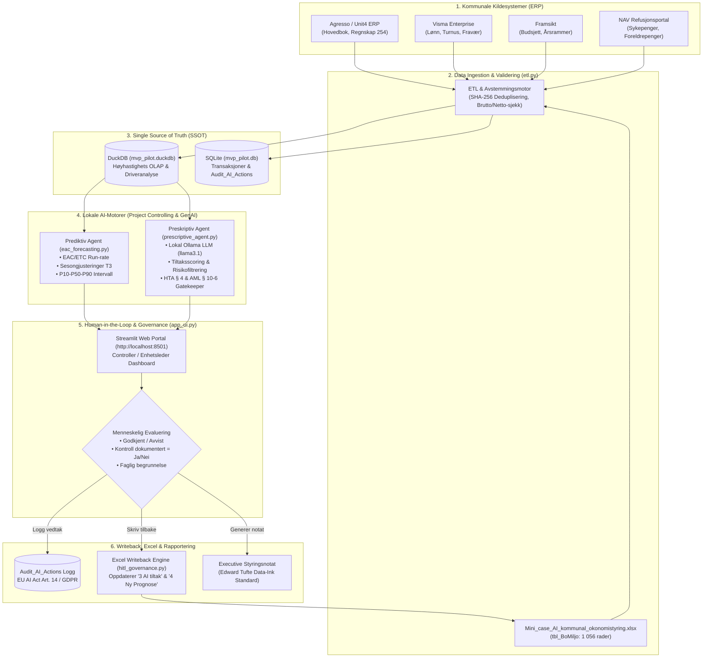
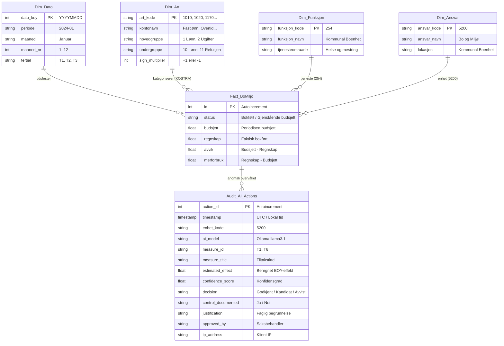
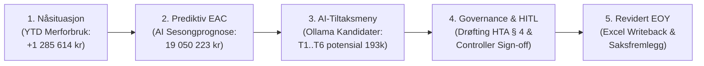
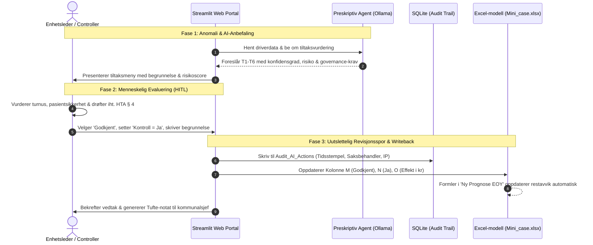

# Kristiansand EPM · MVP-Pilot: AI i Kommunal Økonomistyring
### Bo og Miljø (Enhet 5200 · KOSTRA Funksjon 254)
**Ansvarlig:** Frank Ellingsen · Controller & BI-spesialist  
**Metodikk:** Antigravity EPM · Kanonisk Datamodell · Lokal LLM (Ollama) · Human-in-the-Loop (HITL)  
**Standarder & Lovverk:** Kommuneloven §§ 14-5 og 14-6 · Hovedtariffavtalen (HTA) § 4 · EU AI Act (Art. 13 & 14)  

---

## Innholdsfortegnelse
1. [Executive Summary & Formål](#1-executive-summary--formål)
2. [End-to-End Systemarkitektur & Informasjonsflyt](#2-end-to-end-systemarkitektur--informasjonsflyt)
3. [ERP-Integrasjon & Kildesystemer](#3-erp-integrasjon--kildesystemer)
4. [Kanonisk Datamodell (Star Schema & DuckDB/SQLite)](#4-kanonisk-datamodell-star-schema--duckdbsqlite)
5. [Styrings-Workflow (5-Trinns Sløyfe)](#5-styrings-workflow-5-trinns-sløyfe)
6. [Hvordan AI er integrert med Human-in-the-Loop (HITL)](#6-hvordan-ai-er-integrert-med-human-in-the-loop-hitl)
7. [Prediktiv EAC/ETC Modellering (Prosjektcontrolling)](#7-prediktiv-eacetc-modellering-prosjektcontrolling)
8. [Preskriptiv AI & Lokal LLM (Ollama)](#8-preskriptiv-ai--lokal-llm-ollama)
9. [Mappestruktur & Moduler](#9-mappestruktur--moduler)
10. [Hurtigstart & Kjøreveiledning](#10-hurtigstart--kjøreveiledning)

---

## 1. Executive Summary & Formål

Denne piloten etablerer en operativ, lokal og revisjonssikker AI-arkitektur for proaktiv virksomhetsstyring i **Kristiansand kommune**, anvendt på enheten **Bo og Miljø** (Helse og mestring, KOSTRA funksjon 254). 

Piloten er direkte forankret i regnskapscasen og styringsmodellen i [`Mini_case_AI_kommunal_okonomistyring.xlsx`](file:///c:/Users/frank/Desktop/KrsKom/use%20cases/Mini_case_AI_kommunal_okonomistyring.xlsx).

### Bakgrunn og Utfordringsbilde
* **Døgnkontinuerlig drift (24/7):** Bo og Miljø er en bemanningsintensiv enhet preget av turnuspress, uforutsett sykefravær, vikarbyråkostnader og etterslep på NAV-refusjoner.
* **Reaktiv styring:** Tradisjonell tertialrapportering gir styringsinformasjon 45–60 dager etter periodeslutt. Når avviket oppdages, er handlingsrommet for inneværende budsjettår tapt.
* **Sjablongmessige prognoser:** Excel-modeller opererer ofte med statiske regler (f.eks. «50 % av YTD-avvik videreføres»), uten å dekomponere faste stillingskostnader, variable vikarutgifter eller tidsforskyvninger i refusjonskrav.

### Pilotens Løsning
Piloten transformerer denne manuelle Excel-arbeidsboken til en **levende, datadrevet styringsmotor**:
1. **Lokal ETL i DuckDB & SQLite:** Konsoliderer transaksjonsdataene, håndterer fortegnskonvensjoner og KOSTRA-koding deterministisk.
2. **Prediktiv EAC/ETC (Project Controlling):** Erstatter forenklede sjablonger med en sesongjustert tidsseriemodell og konfidensintervaller (P10–P50–P90).
3. **Preskriptiv AI-Agent (Ollama):** Kjører mot lokal språkmodell (`llama3.1` / `qwen2.5`) for å foreslå og risikovurdere tiltak opp mot tariffavtaler (HTA § 4) og arbeidsmiljøloven.
4. **Human-in-the-Loop (HITL) & Writeback:** Ingen AI-estimater bokføres automatisk. Enhetsleder/controller må godkjenne tiltak i en dedikert webportal, som skriver oppdaterte vedtak tilbake til Excel og logger alt i et uutslettelig revisjonsspor.

---

## 2. End-to-End Systemarkitektur & Informasjonsflyt

Følgende Mermaid-diagram illustrerer den komplette arkitekturen – fra kommunale kildesystemer, via analytiske databaser og lokale AI-agenter, til Human-in-the-Loop portalen og toveis synkronisering med Excel:



---

## 3. ERP-Integrasjon & Kildesystemer

I Kristiansand kommune hentes økonomiske styringsdata fra tre sentrale kilder:
1. **Agresso / Unit4 ERP:** Kommunens økonomisystem. Leverer transaksjoner på art, ansvar, funksjon og prosjekt.
2. **Visma Enterprise / Ressursstyring:** Fagsystem for turnus, timelister, variable tillegg (art 1020/1040) og sykefraværsstatistikk.
3. **Framsikt:** Kommunens verktøy for budsjettfordeling, handlingsprogram og formelle tertialrapporter.

### Regnskapsprinsipper og Validering
I henhold til **Kommuneloven § 14-6** gjelder følgende strenge regler som ivaretas av [etl.py](file:///c:/Users/frank/Desktop/KrsKom/use%20cases/mvp-pilot/etl.py):
* **Bruttoprinsippet:** Utgifter og inntekter skal føres brutto. Det er ikke tillatt å nettoføre vikarlønn (art 1050) direkte mot mottatte refusjoner (art 1170). Begge linjer må analyseres uavhengig.
* **Anordningsprinsippet:** Alle kjente utgifter og inntekter i perioden skal regnskapsføres, uavhengig av betalingstidspunkt.
* **Fortegnskonvensjon:** I modellen lagres utgifter som positive tall og inntekter/refusjoner med negativt fortegn. Avvik beregnes som:
  $$\text{Merforbruk} = \text{Regnskap} - \text{Budsjett}$$
  Et positivt avvik indikerer overforbruk (merforbruk), mens et negativt avvik indikerer mindreforbruk.

### Avstemmingskontroll
Ved innlasting fra `Mini_case_AI_kommunal_okonomistyring.xlsx` (arket `Rådata BoEnhet pr 2tertial`) verifiseres datasettet mot kontrollcellene i arket `Metode og kontroll`:
* **Bokførte rader (Jan–Aug 2024):** 704 rader
* **Gjenstående budsjettrader (Sep–Des 2024):** 352 rader
* **Sum Bokført Budsjett YTD:** 11 337 237,00 kr
* **Sum Bokført Regnskap YTD:** 12 622 851,42 kr
* **Sum Bokført Merforbruk YTD:** 1 285 614,42 kr (+11,3 %)
* **Gjenstående budsjett T3:** 5 896 454,00 kr
* **Totalt Årsbudsjett (BAC):** 17 233 691,00 kr

---

## 4. Kanonisk Datamodell (Star Schema & DuckDB/SQLite)

Datamodellen er bygget som et relasjonelt stjerneskjema (Star Schema), optimalisert for raske analytiske aggregeringer i **DuckDB** og transaksjonssikkerhet i **SQLite**.



---

## 5. Styrings-Workflow (5-Trinns Sløyfe)

Arbeidsflyten speiler strukturen i Excel-arkene, men automatiserer kalkylene og forankrer beslutningene:



1. **Trinn 1 – Nåsituasjon (Ark `1 Nåsituasjon`):**
   * Avstemmer regnskap mot budsjett pr. 2. tertial.
   * DuckDB identifiserer at lønn (undergruppe 10) står for 1,17 mill. kr av avviket, mens uavstemte refusjoner (undergruppe 11) utgjør 128 000 kr.
2. **Trinn 2 – EOY-Prognose før nye tiltak (Ark `2 Prognose EOY`):**
   * Beregner Estimate at Completion (EAC).
   * Modellen identifiserer et ukompensert merforbruk på mellom 1,70 og 1,93 mill. kr (RØDT styringssignal).
3. **Trinn 3 – Preskriptive AI-kandidattiltak (Ark `3 AI tiltak og effekt`):**
   * Lokal LLM (Ollama) analyserer avviksmatrisen og genererer/evaluerer 6 kandidattiltak (T1–T6).
   * Hvert tiltak tildeles effektbase, realiseringssannsynlighet, tjenesterisiko og tariffbarrierer.
4. **Trinn 4 – Governance Gate & Human-in-the-Loop:**
   * **Stage-Gate kontroll:** Krever at formell fagkontroll, HR/tariff-avklaring eller HMS-vurdering er dokumentert.
   * Ingen tiltak kan påvirke regnskapsprognosen før status settes til `Godkjent` OG kontroll settes til `Ja`.
5. **Trinn 5 – Ny Prognose og Writeback (Ark `4 Ny Prognose EOY` & `Styringsoversikt`):**
   * Godkjent effekt summeres inn i «Godkjent spor».
   * Resultatene skrives direkte tilbake til Excel-filen og oppdaterer scenariobroen og restavviket mot årsbudsjettet.

---

## 6. Hvordan AI er integrert med Human-in-the-Loop (HITL)

Et kjerneelement i prosjektet er etterlevelse av **ansvarlig AI (Responsible AI)**. I offentlig forvaltning kan ikke en AI fatte autonome beslutninger som påvirker bemanning, tjenestetilbud eller budsjettildeling.



### De Tre Forankringspilarene for HITL:

#### A. Juridisk og Forvaltningsmessig Forankring
* **Kommuneloven § 14-5:** Kommunedirektøren og enhetsledere har det udelte ansvaret for at virksomheten drives innenfor bevilgede rammer. AI fungerer utelukkende som beslutningsstøtte.
* **Hovedtariffavtalen (HTA) § 4:** Endringer i bemanningsplan, vikarbruk eller turnusordninger utløser drøftingsplikt med de tillitsvalgte. AI-agenten flagger tiltak T2, T3 og T5 med `KREVER HR/TARIFF`, slik at leder ikke iverksetter kutt uten partssamarbeid.
* **EU AI Act (Art. 14 Human Oversight):** Systemet krever at et menneske til enhver tid kan overstyre, forkaste eller endre AI-modellens anbefalinger.

#### B. Teknisk Gjennomføring i Koden
I modulen [hitl_governance.py](file:///c:/Users/frank/Desktop/KrsKom/use%20cases/mvp-pilot/hitl_governance.py) er formell godkjenning implementert slik:
```python
# Excel-formelen i '3 AI tiltak og effekt' kolonne O:
# =IF(AND(M6="Godkjent", N6="Ja"), H6, 0)
```
Dersom enhetsleder kun setter `Beslutning = Godkjent`, men unnlater å dokumentere kontrollen (`Kontroll dokumentert = Nei`), returnerer formelen `0 kr`. Dette tvinger frem etterlevelse av internkontrollforskriften før økonomisk gevinst godskrives.

#### C. Uutslettelig Revisjonsspor (Audit Trail)
Alle handlinger logges i tabellen `Audit_AI_Actions` i [mvp_pilot.db](file:///c:/Users/frank/Desktop/KrsKom/use%20cases/mvp-pilot/mvp_pilot.db):
* Tidsstempel og IP-adresse
* Modellnavn og versjon (`Ollama llama3.1`)
* Beregnet effekt og sannsynlighetsgrad
* Saksbehandlers identitet og skriftlige begrunnelse

---

## 7. Prediktiv EAC/ETC Modellering (Prosjektcontrolling)

Tradisjonell økonomistyring benytter ofte lineære sjablonger. I prosjektcontrolling benyttes Earned Value Management-begreper tilpasset kommunal drift:
* **BAC (Budget at Completion):** Årsbudsjett = 17 233 691 kr.
* **ACWP (Actual Cost of Work Performed):** Bokført regnskap YTD (Jan–Aug) = 12 622 851 kr.
* **ETC (Estimate to Complete):** Forventet kostnad for gjenstående periode (Sep–Des).
* **EAC (Estimate at Completion):** Sluttprognose = $\text{ACWP} + \text{ETC}$.

Modulen [eac_forecasting.py](file:///c:/Users/frank/Desktop/KrsKom/use%20cases/mvp-pilot/eac_forecasting.py) beregner og sammenligner tre uavhengige modeller:

| Modell | Metodikk | EAC (Sluttkostnad) | Avvik mot BAC | Avvik % |
| :--- | :--- | ---: | ---: | :--- |
| **1. Excel Sjablong** | $\text{YTD Regnskap} + \text{Restbudsjett} + (0{,}50 \times \text{Avvik})$ | 19 162 113 kr | +1 928 422 kr | -11,2 % (RØD) |
| **2. Lineær Run-rate** | Mekanisk ekstrapolering: $(\text{YTD} / 8) \times 12$ | 18 934 277 kr | +1 700 586 kr | -9,9 % (GUL) |
| **3. AI Sesongmodell** | KOSTRA-artsnivå m/ sesongvekting (høsttillegg, NAV-lag) | **19 050 223 kr** | **+1 816 532 kr** | **-10,5 % (RØD)** |

### Konfidensintervaller (Stresstesting)
* **P10 (Optimistisk scenario):** 18 650 263 kr (Rask refusjonsinngang, lavt høstfravær)
* **P50 (Forventningsrett):** 19 050 223 kr (Mest sannsynlig utfall uten nye tiltak)
* **P90 (Pessimistisk scenario):** 19 449 544 kr (Høyt influensafravær, økt overtid i helgene)

---

## 8. Preskriptiv AI & Lokal LLM (Ollama)

Modulen [prescriptive_agent.py](file:///c:/Users/frank/Desktop/KrsKom/use%20cases/mvp-pilot/prescriptive_agent.py) orkestrerer en lokal språkmodell via Ollamas REST API (`http://localhost:11434`).

### Tiltaksmenyen (T1–T6)

| ID | Tiltaksbeskrivelse | Horisont | Effektbase | Sannsynlighet | EOY-Effekt | Tjenesterisiko | Tariff / HR | Governance Gate |
| :--- | :--- | :--- | ---: | ---: | ---: | ---: | ---: | :--- |
| **T1** | Oppfølging av refusjoner og krav | Kort | 732 705 kr | 85 % | **41 324 kr** | 5 % | 5 % | `KREVER FAGKONTROLL` |
| **T2** | Redusere vikarbruk via intern dekning | Kort | 612 450 kr | 70 % | **28 872 kr** | 15 % | 25 % | `KREVER HR/TARIFF` |
| **T3** | Redusere overtid gjennom planlegging | Kort | 1 105 444 kr | 75 % | **55 077 kr** | 15 % | 25 % | `KREVER HR/TARIFF` |
| **T4** | Kontroll av ikke-kritiske kjøp | Kort | 155 776 kr | 90 % | **9 520 kr** | 10 % | 5 % | `KREVER FAGKONTROLL` |
| **T5** | Turnus- og kapasitetsanalyse | Lang | 4 789 479 kr | 60 % | **27 474 kr** | 10 % | 25 % | `KREVER HR/TARIFF` |
| **T6** | Digital oppfølging og planprosess | Lang | 17 233 691 kr | 60 % | **30 701 kr** | 5 % | 5 % | `KREVER FAGKONTROLL` |

*Samlet modellert kandidatpotensial:* **192 967 kr**.  
*Netto risikovektet rangering:* AI-agenten prioriterer **T1 (refusjoner)** og **T3 (overtidsplanlegging)** som tiltakene med høyest forventet kontanteffekt og lavest implementeringsrisiko.

---

## 9. Mappestruktur & Moduler

```text
mvp-pilot/
├── config.py                 # Felles konfigurasjon (stier, databaser, Ollama URL og modeller)
├── etl.py                    # ETL: Leser tbl_BoMiljo fra Excel, laster DuckDB og SQLite
├── eac_forecasting.py        # Prediktiv motor: Beregner EAC, ETC og konfidensintervaller
├── prescriptive_agent.py     # Preskriptiv agent: Ollama integrasjon og tiltaksscoring
├── hitl_governance.py        # HITL motor: Excel writeback og logging til Audit_AI_Actions
├── executive_report.py       # Rapportmotor: Genererer Tufte-formaterte styringsnotater (.md)
├── app_ui.py                 # Streamlit webportal for controller og enhetsledelse
├── run_web.py                # Dedikert Python-starter for webportalen
├── run_streamlit.bat         # Ett-klikks Windows batch-starter
├── run_streamlit.ps1         # PowerShell starter
├── run_pilot.py              # CLI-grensesnitt for automatisert kjøring
├── mvp_pilot.db              # Lokal SQLite database med revisjonslogg
├── mvp_pilot.duckdb          # Analytisk DuckDB database for hurtige spørringer
├── README.md                 # Dette dokumentet
└── reports/                  # Genererte styringsnotater til kommunalsjef
```

---

## 10. Hurtigstart & Kjøreveiledning

### Forutsetninger
* Python 3.10 eller nyere installert.
* Nødvendige biblioteker: `pip install duckdb openpyxl pandas streamlit sqlite3`.
* (Valgfritt) Lokal **Ollama** kjørende med `llama3.1:latest` (`ollama serve`).

### 1. Start Web-Portalen (Anbefalt)
Du kan starte den interaktive Streamlit-portalen på fire måter:
* **Via Python launcher:**
  ```powershell
  cd "C:\Users\frank\Desktop\KrsKom\use cases\mvp-pilot"
  python run_web.py
  ```
* **Via Windows Utforsker:** Dobbeltklikk på `run_streamlit.bat`.
* **Via PowerShell:**
  ```powershell
  .\run_streamlit.ps1
  ```
* **Via direkte Streamlit:**
  ```powershell
  streamlit run app_ui.py
  ```
Åpne deretter **http://localhost:8501** i nettleseren.

### 2. Kjør Hele Pipelinen via Kommandolinjen (CLI)
For automatisert kjøring av datainnlasting, prognoser, AI-analyse og rapportgenerering:
```powershell
python run_pilot.py --pipeline
```

### 3. Delvise Kjøringer
* Kun oppdatere databasene fra Excel: `python run_pilot.py --etl`
* Kun beregne EAC-prognoser: `python run_pilot.py --forecast`
* Kun evaluere tiltak via Ollama: `python run_pilot.py --agent`
* Kun generere nytt Tufte-notat: `python run_pilot.py --report`
