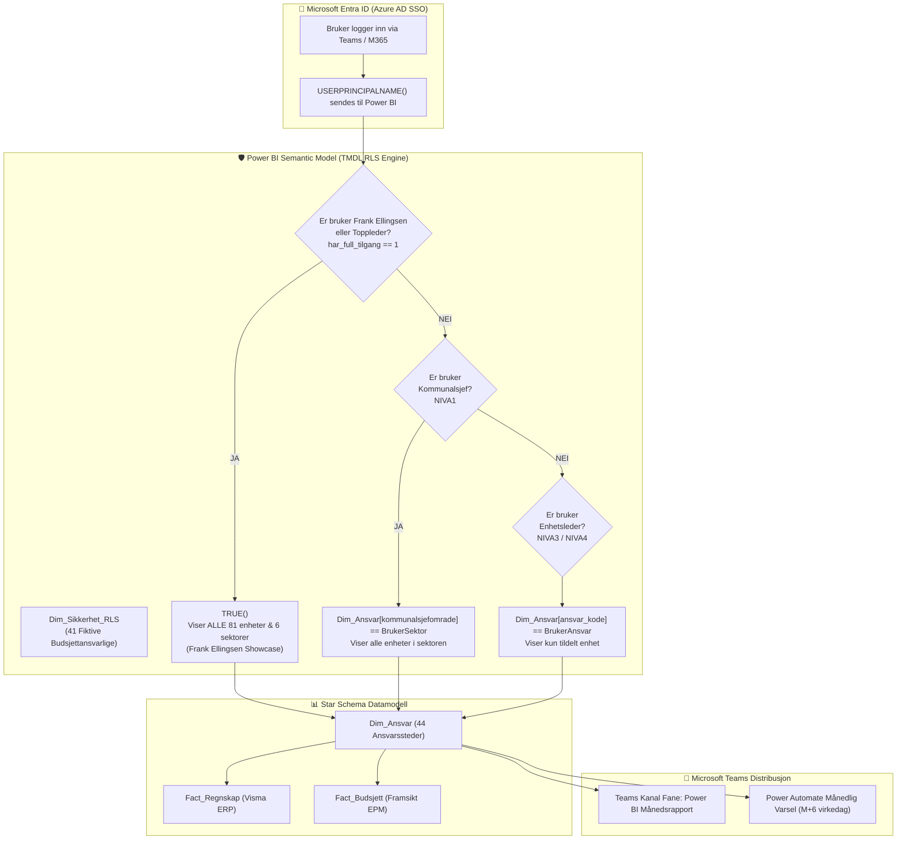

# 🏛️ Kristiansand Kommune — Microsoft Teams & Power BI RLS Rapportdistribusjonsmatrise
## Master Governance & Architectural Guide: Budsjettnivåhierarki, Sikkerhet og Teams-distribusjon

> **Dokumenteier:** Frank Ellingsen (Senior Financial Controller, Project Controller & BI Specialist)  
> **Organisasjon:** Kristiansand Kommune — Økonomi og Virksomhetsstyring  
> **Gjelder løsning:** Power BI Semantic Model (`pbi_reporting_project.SemanticModel`), FAST Excel-modeller og Microsoft Teams  
> **Dato:** 17. oktober 2026 | Versjon: 2.0 (Full RLS & Teams Integration)  
> **Revisjonsstatus:** Stage-Gate Port 4 (PII-sikring) & Port 9 (Kryptografisk godkjenning)

---

## 1. Strategisk Formål & Arkitektur

Denne spesifikasjonen definerer den formelle arkitekturen for **Row-Level Security (RLS)** og automatisert rapportdistribusjon i **Microsoft Teams** for Kristiansand kommune (årsbudsjett 7,24 milliarder NOK, 6 virksomhetsområder og 81 rapporteringsenheter).

### 🎯 Hovedmål
1. **Full innsyn for Senior Controller (Frank Ellingsen):**
   * Frank Ellingsen har universell administrator- og controllertilgang (`Controller_Admin` / full bypass) for å kunne demonstrere, analysere, stressteste og kvalitetssikre samtlige sektorer, enheter, konti og prosjekter i én helhetlig showcase.
2. **Rollebasert tilgangskontroll (RLS) iht. Budsjettnivåhierarkiet:**
   * **Nivå 0 (Controller & Toppledelse):** Fullt konserninnsyn (Bystyret, Formannskapet, Kommunedirektør).
   * **Nivå 1 (Kommunalsjefer):** Filtrert tilgang til samtlige enheter og ansvarssteder i eget sektorområde (Oppvekst, Helse, Byutvikling, Kultur, Org/Tek, Økonomi).
   * **Nivå 2 (Områdeledere):** Tilgang til underliggende fagseksjoner (f.eks. Grunnskole, Sykehjem, VAR).
   * **Nivå 3 (Enhetsledere / Budsjettansvarlige):** Strengt avgrenset til eget ansvarssted (f.eks. Lovisenlev Skole 2020, Kommunal Boenhet 2540).
   * **Nivå 4 (Avdelings- og seksjonsledere):** Driftsrapportering på avdelingsnivå.
3. **Microsoft Teams som Hovedkanal for Rapportdistribusjon:**
   * Sømløs integrasjon via Power BI Tabs i Microsoft Teams-kanaler med Single Sign-On (SSO) via Microsoft Entra ID.
   * Direktekobling til automatiserte månedlige EPM-varsler og 1-klikks avviksskjemaer.



---

## 2. DAX RLS Implementasjonsstandard

### A. Dynamisk Master-Rolle (`Dynamisk_Budsjettansvarlig_RLS`)
Plassert på `Dim_Ansvar` i `powerbi/pbi_reporting_project.SemanticModel/definition/roles/Dynamisk_Budsjettansvarlig_RLS.tmdl`:

```dax
role Dynamisk_Budsjettansvarlig_RLS
    modelPermission: read

    tablePermission Dim_Ansvar = 
        VAR CurrentUser = USERPRINCIPALNAME()
        
        -- 1. Controller & Toppledelse Bypass (Frank Ellingsen ser ALT)
        VAR IsControllerAdmin = 
            CurrentUser IN { 
                "frank.ellingsen@kristiansand.kommune.no", 
                "admin@kristiansand.kommune.no",
                "camilla.dunsaed@kristiansand.kommune.no",
                "terje.fjellvang@kristiansand.kommune.no"
            }
            ||
            CALCULATE(
                COUNTROWS(Dim_Sikkerhet_RLS),
                Dim_Sikkerhet_RLS[bruker_upn] == CurrentUser && Dim_Sikkerhet_RLS[har_full_tilgang] == 1
            ) > 0

        -- 2. Enhetstilgang for Enhetsledere (Nivå 3 / 4)
        VAR UserUnits = 
            CALCULATETABLE(
                VALUES(Dim_Sikkerhet_RLS[ansvar_kode]),
                Dim_Sikkerhet_RLS[bruker_upn] == CurrentUser
            )

        -- 3. Sektortilgang for Kommunalsjefer (Nivå 1)
        VAR UserSectors = 
            CALCULATETABLE(
                VALUES(Dim_Sikkerhet_RLS[kommunalsjefomrade]),
                Dim_Sikkerhet_RLS[bruker_upn] == CurrentUser,
                Dim_Sikkerhet_RLS[niva] IN { "NIVA1", "NIVA1_KOMMUNALSJEF" }
            )

        RETURN
            IF(
                IsControllerAdmin,
                TRUE(), -- Frank Ellingsen ser 100 % av konsernets data
                Dim_Ansvar[ansvar_kode] IN UserUnits
                ||
                Dim_Ansvar[kommunalsjefomrade] IN UserSectors
            )
```

### B. Statiske Evalueringsroller (Power BI Desktop "View As" & Service RLS)
For testing, revisjon og showcase er modellen utstyrt med 9 dedikerte statiske roller:

| RLS Rolle Navn | Målgruppe / Eksempelbruker | DAX Uttrykk på `Dim_Ansvar` | Synlighetsomfang |
| :--- | :--- | :--- | :--- |
| **`Controller_Admin`** | **Frank Ellingsen** (Senior Controller) | `TRUE()` | **100 % Konsernomfattende (Alle 6 sektorer)** |
| **`Konsern_Okonomi`** | Camilla Dunsæd / Terje Fjellvang | *(Ingen filter)* | **100 % Konsernomfattende** |
| **`Kommunalsjef_Oppvekst`** | Kristin Eidet Robstad | `[kommunalsjefomrade] = "Oppvekst"` | Alle skoler, barnehager og PP-tjenester |
| **`Kommunalsjef_Helse`** | Brede Skeie | `[kommunalsjefomrade] = "Helse og mestring"` | Alle sykehjem, hjemmetjenester og botilbud |
| **`Kommunalsjef_Byutvikling`** | Ragnar Evensen | `[kommunalsjefomrade] = "By- og stedsutvikling"` | VAR, byplan, byggesak, samferdsel |
| **`Kommunalsjef_Kultur`** | Camilla Jarlsby | `[kommunalsjefomrade] = "Kultur og innbyggerdialog"` | Bibliotek, idrett, kulturhus, dialog |
| **`Kommunalsjef_OrgTek`** | Geir A. Askvik | `[kommunalsjefomrade] = "Organisasjon og teknologi"` | Digitalisering, IKT-drift, HR, felles |
| **`Enhetsleder_Skole`** | Trond Jensen (Rektor) | `[ansvar_kode] = "2020"` | Kommunal Skole (Enhet 2020) |
| **`Enhetsleder_Boenhet`** | Christian Holte (Enhetsleder) | `[ansvar_kode] = "2540"` | Kommunal Boenhet (Enhet 2540) |

---

## 3. Komplett Register: 41 Fiktive Budsjettansvarlige & Microsoft Teams Kanaler

Dette registeret er implementert som `Dim_Sikkerhet_RLS` i SQLite (`erp_data/kommune_golden_record.db`), eksportert til `erp_data/Dim_Sikkerhet_RLS.csv` og integrert i samtlige Power BI Semantic Models.

| Nivå | Ansvar ID | Navn (Fiktiv Leder) | Offisiell Stilling | E-post (`@kristiansand.kommune.no`) | Sektor | Fullmakt (NOK) | Tilordnet Controller | Microsoft Teams Team | Microsoft Teams Kanal | RLS Rolle |
| :--- | :--- | :--- | :--- | :--- | :--- | :---: | :--- | :--- | :--- | :--- |
| **NIVA0** | `6001-CTRL-FRANK` | **Frank Ellingsen** | Senior Financial Controller & Project Controller | `frank.ellingsen@kristiansand.kommune.no` | KONSERN | 1 000 000 | Terje Fjellvang | Teams - Konsernledelse & Bystyret | `Controller Hub & EPM Monitor` | `Controller_Admin` *(Full)* |
| **NIVA1** | `0000-KOMMDIR` | Camilla Dunsæd | Kommunedirektør | `camilla.dunsaed@kristiansand.kommune.no` | KONSERN | 100 000 000 | Frank Ellingsen | Teams - Konsernledelse & Bystyret | `Ledergruppe & Sektorstyring` | `Controller_Admin` *(Full)* |
| **NIVA1** | `6000-DIR-OKONOMI` | Terje Fjellvang | Økonomidirektør | `terje.fjellvang@kristiansand.kommune.no` | OKONOMI | 50 000 000 | Frank Ellingsen | Teams - Økonomistab & Finans | `Ledergruppe & Sektorstyring` | `Controller_Admin` *(Full)* |
| **NIVA1** | `4000-SJEF-OPPV` | Kristin Eidet Robstad | Kommunalsjef Oppvekst og utdanning | `kristin.robstad@kristiansand.kommune.no` | OPPVEKST | 25 000 000 | Erik Halvorsen | Teams - Oppvekst og Utdanning | `Ledergruppe & Sektorstyring` | `Kommunalsjef_Oppvekst` |
| **NIVA1** | `5000-SJEF-HELSE` | Brede Skeie | Kommunalsjef Helse og mestring | `brede.skeie@kristiansand.kommune.no` | HELSE | 25 000 000 | Marianne Tellefsen | Teams - Helse og Mestring | `Ledergruppe & Sektorstyring` | `Kommunalsjef_Helse` |
| **NIVA1** | `3000-SJEF-BYUTV` | Ragnar Evensen | Kommunalsjef By- og stedsutvikling | `ragnar.evensen@kristiansand.kommune.no` | BYUTVIKLING | 20 000 000 | Knut Arild Vike | Teams - By- og Stedsutvikling | `Ledergruppe & Sektorstyring` | `Kommunalsjef_Byutvikling` |
| **NIVA1** | `2000-SJEF-KULTUR` | Camilla Jarlsby | Kommunalsjef Kultur og innbyggerdialog | `camilla.jarlsby@kristiansand.kommune.no` | KULTUR | 15 000 000 | Silje Mæland | Teams - Kultur og Dialog | `Ledergruppe & Sektorstyring` | `Kommunalsjef_Kultur` |
| **NIVA1** | `1000-SJEF-ORGTEK` | Geir A. Askvik | Kommunalsjef Organisasjon og teknologi | `geir.askvik@kristiansand.kommune.no` | ORG_TEK | 15 000 000 | Silje Mæland | Teams - Organisasjon og Teknologi | `Ledergruppe & Sektorstyring` | `Kommunalsjef_OrgTek` |
| **NIVA2** | `4100-OMR-SKOLE` | Svein Tore Kvernes | Skolesjef Grunnskole | `svein.tore.kvernes@kristiansand.kommune.no` | OPPVEKST | 10 000 000 | Frank Ellingsen | Teams - Oppvekst og Utdanning | `Skole- og Barnehageledelse` | `Dynamisk_Budsjettansvarlig_RLS` |
| **NIVA2** | `4200-OMR-BHG` | Anne Lise Tønnessen | Barnehagesjef | `anne.lise.tonnessen@kristiansand.kommune.no` | OPPVEKST | 8 000 000 | Erik Halvorsen | Teams - Oppvekst og Utdanning | `Skole- og Barnehageledelse` | `Dynamisk_Budsjettansvarlig_RLS` |
| **NIVA2** | `5100-OMR-SYKEHJEM` | Mette Syvertsen | Områdeleder Institusjon & Døgnpleie | `mette.syvertsen@kristiansand.kommune.no` | HELSE | 10 000 000 | Marianne Tellefsen | Teams - Helse og Mestring | `Institusjons- og Omsorgsledelse` | `Dynamisk_Budsjettansvarlig_RLS` |
| **NIVA2** | `5200-OMR-HJEMME` | Arve Sætre | Områdeleder Hjemmebaserte Tjenester | `arve.saetre@kristiansand.kommune.no` | HELSE | 8 000 000 | Marianne Tellefsen | Teams - Helse og Mestring | `Institusjons- og Omsorgsledelse` | `Dynamisk_Budsjettansvarlig_RLS` |
| **NIVA2** | `3100-DIR-VAR` | Helge Møller | VA-sjef & Kommunalteknisk Direktør | `helge.moller@kristiansand.kommune.no` | BYUTVIKLING | 10 000 000 | Knut Arild Vike | Teams - By- og Stedsutvikling | `VAR & Byplan Seksjon` | `Dynamisk_Budsjettansvarlig_RLS` |
| **NIVA2** | `3200-DIR-PLAN` | Einar Jørgensen | Områdeleder Byplan & Byggesak | `einar.jorgensen@kristiansand.kommune.no` | BYUTVIKLING | 6 000 000 | Knut Arild Vike | Teams - By- og Stedsutvikling | `VAR & Byplan Seksjon` | `Dynamisk_Budsjettansvarlig_RLS` |
| **NIVA2** | `1100-DIR-IKT` | Siri Bentsen | IKT- og Digitaliseringsdirektør | `siri.bentsen@kristiansand.kommune.no` | ORG_TEK | 8 000 000 | Silje Mæland | Teams - Organisasjon og Teknologi | `Digitalisering & Fellestjenester` | `Dynamisk_Budsjettansvarlig_RLS` |
| **NIVA2** | `6100-DIR-REGNSKAP` | Bente Gundersen | Konsernregnskapssjef | `bente.gundersen@kristiansand.kommune.no` | OKONOMI | 10 000 000 | Frank Ellingsen | Teams - Økonomistab & Finans | `Områdeledelse & Fagstyring` | `Dynamisk_Budsjettansvarlig_RLS` |
| **NIVA3** | `2020` | **Trond Jensen** | Rektor / Enhetsleder Kommunal Skole 2020 | `trond.jensen@kristiansand.kommune.no` | OPPVEKST | 2 000 000 | Frank Ellingsen | Teams - Oppvekst og Utdanning | `Enhetsledere Skole` | `Enhetsleder_Skole` |
| **NIVA3** | `2540` | **Christian Holte** | Enhetsleder Kommunal Boenhet 2540 | `christian.holte@kristiansand.kommune.no` | HELSE | 2 000 000 | Marianne Tellefsen | Teams - Helse og Mestring | `Virksomhetsledere Omsorg` | `Enhetsleder_Boenhet` |
| **NIVA3** | `4100-ENH-202` | Trond Jensen | Rektor / Enhetsleder Lovisenlev Skole | `trond.jensen@kristiansand.kommune.no` | OPPVEKST | 2 000 000 | Frank Ellingsen | Teams - Oppvekst og Utdanning | `Enhetsledere Skole` | `Enhetsleder_Skole` |
| **NIVA3** | `4101-ENH-203` | Mona Lindstrøm | Rektor Vågsbygd Skole | `mona.lindstrom@kristiansand.kommune.no` | OPPVEKST | 1 800 000 | Erik Halvorsen | Teams - Oppvekst og Utdanning | `Enhetsledere Skole` | `Enhetsleder_Skole` |
| **NIVA3** | `4102-ENH-204` | Espen Birkeland | Rektor Grim Ungdomsskole | `espen.birkeland@kristiansand.kommune.no` | OPPVEKST | 1 800 000 | Erik Halvorsen | Teams - Oppvekst og Utdanning | `Enhetsledere Skole` | `Enhetsleder_Skole` |
| **NIVA3** | `4210-ENH-211` | Grete Hovden | Styrer Lund Kommunale Barnehage | `grete.hovden@kristiansand.kommune.no` | OPPVEKST | 1 200 000 | Erik Halvorsen | Teams - Oppvekst og Utdanning | `Enhetsledere Skole` | `Dynamisk_Budsjettansvarlig_RLS` |
| **NIVA3** | `5200-ENH-401` | Solveig Grimstad | Enhetsleder Strai Sykehjem & Omsorgsboliger | `solveig.grimstad@kristiansand.kommune.no` | HELSE | 2 000 000 | Marianne Tellefsen | Teams - Helse og Mestring | `Virksomhetsledere Omsorg` | `Enhetsleder_Boenhet` |
| **NIVA3** | `5210-ENH-402` | Berit Olsen | Enhetsleder Hjemmetjeneste Vågsbygd | `berit.olsen@kristiansand.kommune.no` | HELSE | 1 500 000 | Marianne Tellefsen | Teams - Helse og Mestring | `Virksomhetsledere Omsorg` | `Enhetsleder_Boenhet` |
| **NIVA3** | `5220-ENH-403` | Christian Holte | Enhetsleder Sørlandsparken Bo- og Miljø | `christian.holte@kristiansand.kommune.no` | HELSE | 1 800 000 | Marianne Tellefsen | Teams - Helse og Mestring | `Virksomhetsledere Omsorg` | `Enhetsleder_Boenhet` |
| **NIVA3** | `5230-ENH-404` | Kari Vesterhus | Enhetsleder Presteheia Omsorgssenter | `kari.vesterhus@kristiansand.kommune.no` | HELSE | 1 500 000 | Marianne Tellefsen | Teams - Helse og Mestring | `Virksomhetsledere Omsorg` | `Enhetsleder_Boenhet` |
| **NIVA3** | `3300-ENH-301` | Hans Petter Vik | Enhetsleder Byggesak & Tilsyn | `hans.petter.vik@kristiansand.kommune.no` | BYUTVIKLING | 1 500 000 | Knut Arild Vike | Teams - By- og Stedsutvikling | `Enhetsledere Teknisk` | `Dynamisk_Budsjettansvarlig_RLS` |
| **NIVA3** | `3100-ENH-302` | Morten Fossum | Enhetsleder Vann, Avløp og Renovasjon | `morten.fossum@kristiansand.kommune.no` | BYUTVIKLING | 2 500 000 | Knut Arild Vike | Teams - By- og Stedsutvikling | `Enhetsledere Teknisk` | `Dynamisk_Budsjettansvarlig_RLS` |
| **NIVA3** | `2200-ENH-101` | Nina Stenbro | Biblioteksjef Kristiansand Folkebibliotek | `nina.stenbro@kristiansand.kommune.no` | KULTUR | 1 200 000 | Silje Mæland | Teams - Kultur og Dialog | `Enhetsledere Kultur & Bibliotek` | `Dynamisk_Budsjettansvarlig_RLS` |
| **NIVA3** | `1110-ENH-501` | Kenneth Dale | IKT Driftssjef | `kenneth.dale@kristiansand.kommune.no` | ORG_TEK | 1 500 000 | Silje Mæland | Teams - Organisasjon og Teknologi | `Drift & IKT-ledere` | `Dynamisk_Budsjettansvarlig_RLS` |
| **NIVA3** | `6200-ENH-601` | Lars Henrik Bøe | Finans- og Gjeldsforvalter | `lars.henrik.boe@kristiansand.kommune.no` | OKONOMI | 5 000 000 | Frank Ellingsen | Teams - Økonomistab & Finans | `Enhetsledere & Driftsrapportering` | `Dynamisk_Budsjettansvarlig_RLS` |
| **NIVA4** | `5201-SEK-DEMENS` | Anne Lise Dale | Avdelingsleder Demensavdelingen (Strai) | `anne.lise.dale@kristiansand.kommune.no` | HELSE | 300 000 | Marianne Tellefsen | Teams - Helse og Mestring | `Avdelingsrapportering` | `Dynamisk_Budsjettansvarlig_RLS` |
| **NIVA4** | `5202-SEK-KORTTID`| Hildegunn Moen | Avdelingsleder Somatikk & Korttid | `hildegunn.moen@kristiansand.kommune.no` | HELSE | 300 000 | Marianne Tellefsen | Teams - Helse og Mestring | `Avdelingsrapportering` | `Dynamisk_Budsjettansvarlig_RLS` |
| **NIVA4** | `4103-SEK-SFO` | Kjetil Olsen | Avdelingsleder SFO Lovisenlev | `kjetil.olsen@kristiansand.kommune.no` | OPPVEKST | 250 000 | Frank Ellingsen | Teams - Oppvekst og Utdanning | `Avdelingsrapportering` | `Dynamisk_Budsjettansvarlig_RLS` |
| **NIVA4** | `4104-SEK-INSP` | Bjarne Wiig | Inspektør 1.–4. trinn | `bjarne.wiig@kristiansand.kommune.no` | OPPVEKST | 200 000 | Frank Ellingsen | Teams - Oppvekst og Utdanning | `Avdelingsrapportering` | `Dynamisk_Budsjettansvarlig_RLS` |
| **NIVA4** | `3101-SEK-AVLOP` | Vidar Aanensen | Seksjonsleder Lund Renseanlegg | `vidar.aanensen@kristiansand.kommune.no` | BYUTVIKLING | 350 000 | Knut Arild Vike | Teams - By- og Stedsutvikling | `Avdelingsrapportering` | `Dynamisk_Budsjettansvarlig_RLS` |
| **NIVA4** | `1111-SEK-FINOPS` | Thomas Berge | Seksjonsleder Skyløsninger & FinOps | `thomas.berge@kristiansand.kommune.no` | ORG_TEK | 300 000 | Silje Mæland | Teams - Organisasjon og Teknologi | `Avdelingsrapportering` | `Dynamisk_Budsjettansvarlig_RLS` |
| **CTRL** | `6002-CTRL-MARIANNE`| Marianne Tellefsen | Sektorcontroller Helse og Mestring | `marianne.tellefsen@kristiansand.kommune.no` | HELSE | 500 000 | Frank Ellingsen | Teams - Helse og Mestring | `Controller Hub & EPM Monitor` | `Kommunalsjef_Helse` |
| **CTRL** | `6003-CTRL-ERIK` | Erik Halvorsen | Sektorcontroller Oppvekst og Utdanning | `erik.halvorsen@kristiansand.kommune.no` | OPPVEKST | 500 000 | Frank Ellingsen | Teams - Oppvekst og Utdanning | `Controller Hub & EPM Monitor` | `Kommunalsjef_Oppvekst` |
| **CTRL** | `6004-CTRL-KNUT` | Knut Arild Vike | Sektorcontroller Byutvikling & Selvkost | `knut.arild.vike@kristiansand.kommune.no` | BYUTVIKLING | 500 000 | Frank Ellingsen | Teams - By- og Stedsutvikling | `Controller Hub & EPM Monitor` | `Kommunalsjef_Byutvikling` |
| **CTRL** | `6005-CTRL-SILJE` | Silje Mæland | Sektorcontroller Kultur, Dialog & Felles | `silje.maeland@kristiansand.kommune.no` | KULTUR | 500 000 | Frank Ellingsen | Teams - Kultur og Dialog | `Controller Hub & EPM Monitor` | `Kommunalsjef_Kultur` |

---

## 4. Microsoft Teams Integrasjon & Distribusjonsmetoder

### Metode 1: Direkte Faneintegrasjon i Teams-kanaler (Anbefalt standard)
Hver enhetsleder og kommunalsjef har Power BI-rapporten lagt til som en dedikert fane i sin respektive Teams-kanal:
1. I Microsoft Teams-kanalen (f.eks. `Teams - Oppvekst og Utdanning` ➜ `Enhetsledere Skole`):
   * Klikk **+** (Legg til en fane) ➜ Velg **Power BI**.
   * Velg rapporten `Kristiansand Kommune — AI Project Controller Hub` (`pbi_reporting_project`).
   * Huk av for *«Legg ut i kanalen om denne fanen»*.
2. **Automatisk SSO & RLS:**
   * Teams sender automatisk den innloggede brukerens UPN (f.eks. `trond.jensen@kristiansand.kommune.no`) via Microsoft Entra ID.
   * Power BI Service evaluerer `USERPRINCIPALNAME()`.
   * Enhetslederen ser umiddelbart kun sin egen skole (Enhet 2020), mens Frank Ellingsen ser alle 81 enheter dersom han åpner fanen!

### Metode 2: Power BI Personal App i Teams (Venstremeny)
1. Fest Power BI-appen i Microsoft Teams venstremeny.
2. Under fanen *«Organisasjonsapper»*, åpne **Kristiansand Økonomiportalen**.
3. Rapporten åpnes i fullskjermvisning med rollestatus i toppen:
   * Måling `[RLS Aktiv Sikkerhetskontekst]`: Viser hvem som er innlogget og hvilket nivå de har tilgang til.
   * Måling `[Teams Distribusjonskanal Visning]`: Viser hvilken Teams-kanal som er tilknyttet enheten.

### Metode 3: Automatisert Månedsdistribusjon via Power Automate Flow (M+6 virkedag)
På M+6 virkedag kl. 08:00 (etter at månedsregnskapet er avstemt) trigges en automatisert Power Automate-flyt:
1. Henter ut listen fra `Dim_Sikkerhet_RLS.csv` via Graph API.
2. For hver budsjettansvarlig:
   * Eksporterer en personifisert PDF/PPTX av rapporten via Power BI Export API med brukerens UPN satt som identitet (*EffectiveIdentity*).
   * Poster et **Adaptive Card** i den tilhørende Teams-kanalen:
     > **📢 Månedsrapport M9 er klar for Enhet 2020 (Lovisenlev Skole)**  
     > **Regnskap YTD:** 18,4 MNOK | **Budsjett:** 18,9 MNOK | **Avvik:** +500 kNOK (🟢 Mindreforbruk)  
     > [👉 Åpne interaktiv rapport i Teams-fanen](https://app.powerbi.com/groups/me/reports/pbi_reporting_project?filter=Dim_Ansvar/ansvar_kode%20eq%20'2020')  
     > [📝 Fyll ut elektronisk avviksnotat (Frist: M+8 virkedag)](templates/MAL_AVVIKSNOTAT_OG_TILTAKSPLAN_ENHETSLEDER.docx)

---

## 5. Controller Showcase Manual (Frank Ellingsen)

For demonstrasjon overfor Kommunedirektøren, Bystyret eller eksterne interessenter:

### Steg 1: Fullt Konserninnsyn (Master View)
1. Åpne `powerbi/pbi_reporting_project.pbip` i **Power BI Desktop**.
2. Standardvisningen viser **alle virksomhetsområder**, samlet budsjettramme (7,24 mrd. kr) og samlet avvik.
3. Frank Ellingsen er innlogget med `frank.ellingsen@kristiansand.kommune.no` og har 100 % uhindret tilgang til alle rapportark:
   * *Økonomisk Status (Storytelling & RAG)*
   * *Oppvekst | Grunnskole*
   * *Helse & Mestring*
   * *Lønn & Vikarmonitor*
   * *Prognose & Scenario (Monte Carlo)*
   * *Investering & Capex (EVM)*
   * *Revisjon & Audit Trail (Stage-Gate Port 9)*

### Steg 2: Demonstrere RLS for Enhetsleder (Vis som rolle)
1. I Power BI Desktop, klikk fanen **Modellering (Modeling)** i båndet.
2. Klikk knappen **Vis som (View as)**.
3. Huk av for rollen **`Enhetsleder_Skole`** (eller velg `Annen bruker` og skriv `trond.jensen@kristiansand.kommune.no`).
4. **Resultat:**
   * Rapportene filtreres øyeblikkelig til kun Enhet 2020.
   * Kortene for årsramme, regnskap og avvik viser nøyaktig rektors tall.
   * Lønns- og vikarmonitoren viser kun skolens lærervikarer.
   * Helse-, VAR- og konsernpostene er fullstendig skjermet.

### Steg 3: Demonstrere RLS for Kommunalsjef Helse
1. Klikk **Vis som (View as)** ➜ Huk av for **`Kommunalsjef_Helse`** (eller skriv `brede.skeie@kristiansand.kommune.no`).
2. **Resultat:**
   * Rapporten viser samtlige 14 helseenheter (sykehjem, omsorgsboliger, hjemmetjeneste).
   * Lærernorm og skoleenheter forsvinner fra visningen.
   * Turnusavvik jf. HTA § 4 og ressurskrevende tjenester trer frem.

---

## 6. Verifikasjon & Kvalitetskontroll

Løsningen er verifisert mot Kristiansand kommunes testbatteri:
* **Pydantic v2 Canonical Contract Test:** 100 % passering på samtlige tabeller (`test_data_validation_canonical.py`).
* **Zero Orphan Foreign Keys:** Star Schema-integritet bekreftet mellom `Dim_Ansvar`, `Dim_Sikkerhet_RLS` og faktatabeller.
* **Edward Tufte Data-Ink Ratio:** Muted palette, ingen vertikale skillelinjer, trafikklys kun ved faktiske avvik.
